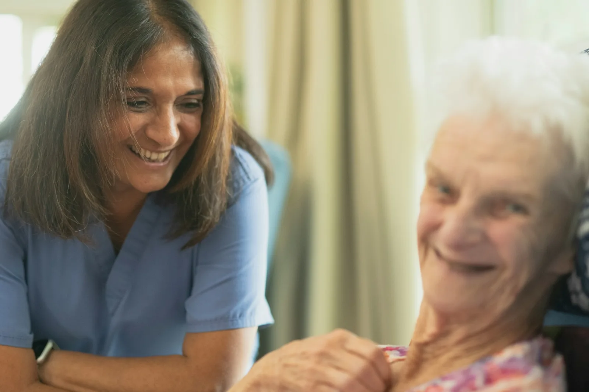
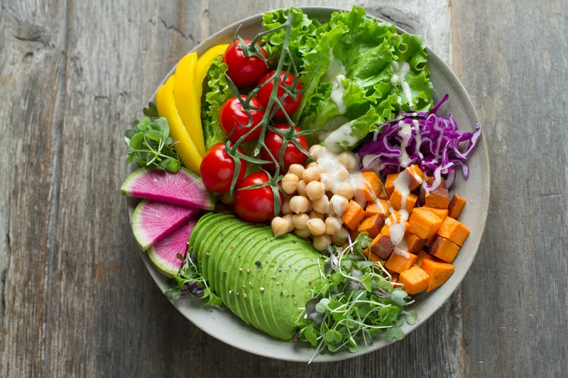

# Tidewell component guide (for page builders)

Brand: **Tidewell Dialysis Centre** (fictional). Tone: calm, warm, reassuring, plain language ("Nothing is rushed").
Currency INR (`₹2,600`, en-IN grouping). Emergency line: 108.
Centres: **Tidewell Chennai (Besant Nagar)** 14 Marina Crescent, Besant Nagar, Chennai 600090, +91 44 4960 2210 (HQ, nocturnal sleep rooms) ·
**Tidewell Bengaluru (Indiranagar)** 22 Lakeview Road, Indiranagar, Bengaluru 560038, +91 80 4960 3315 · **Tidewell Chennai (Anna Nagar)** 7 Park View Road,
Anna Nagar, Chennai 600040, +91 44 4960 2290. Email care@tidewell.example. Shifts Mon to Sat 6:00 to 22:00; nocturnal Mon/Wed/Fri and Tue/Thu/Sat 21:00 to 05:00; nephrologist on call 24/7.
Data: `data/services.json` (4 main treatments + 4 supporting services, rich fields) and `data/team.json` (12 people), also in JS as
`window.Tidewell.services` / `window.Tidewell.team` (from generated `data/site-data.js`).
Dummy patient: **Michael Grant**, michael.grant@example.com, patient ID TW-20417, in-centre haemodialysis Mon/Wed/Fri 07:00 at Chennai (Besant Nagar), Bay B chair 6,
nephrologist Dr Mei Lin Chua, primary nurse Anita Joseph, photo `user-1`. Demo login password `Tidewell123`.

Team (photos `doc-1..4`, `nurse-1..4`, `spec-1..4`, care-team page ONLY): doc-1 Dr Mei Lin Chua (Medical Director), doc-2 Dr Peter Mathias, doc-3 Dr Arjun Menon,
doc-4 Dr Kavya Sharma; nurse-1 Anita Joseph (Nurse Manager), nurse-2 Daniel Mensah, nurse-3 Grace Okafor (home therapies), nurse-4 Thomas Mathew (access);
spec-1 Elena Fernandes (renal dietitian), spec-2 Joseph Adeyemi (social worker), spec-3 Dr Emmanuel Osei (vascular access surgeon), spec-4 Mai Nguyen (coordinator).

## Visual identity (do not drift back to the older sites)
- **Fonts:** headings **Lexend** (400 to 700; h1/h2 weight 600, letter-spacing -0.01em; h3/h4 weight 500), body **Source Sans 3** (line-height 1.7).
  Tokens `--f-head` / `--f-body`. No serif fonts, no `font-variation-settings`, no italic display text. Min text 13px (`--fs-xs`).
- **Palette:** teal primary `--primary #0E7C86` (text-safe `--primary-ink #0A5F67`), mint `--tint #EBF6F3`, sea-glass `--tint-2 #D9EEEA`,
  warm sand `--sand #F6F0E6` / `--sand-2`, warm page `--bg #FBFAF7`, ink `--ink #10303A`, muted `--muted`, soft coral `--accent #E8796B`
  (decorative only; as text use `--accent-ink`). Dark theme is automatic through the tokens.
- **Shapes:** cards and panels `--r-lg` 24px, big frames `--r-xl` 32px, buttons and header controls are **pills** (`--ctl-r: 999px`, 44px high).
- **Layers:** alternate `section` (warm white), `section section--tint` (mint + soft blobs), `section section--sand` (sand + blobs), `section--white`,
  `section--blobs` (white with blobs). One `.band` (deep teal) per page at most. Join differently coloured sections with a **wave** (`{{wave from-to}}`).
- **Motion:** slow fade-ups on scroll, hero photo settle, gentle float on hero stat cards, count-up numbers, smooth FAQ open. Automatic, off for
  reduced-motion and automation. Never add `data-reveal` yourself.

## Rules
- Write ONLY `src/pages/<yourpage>.html`, `css/pages/<page>.css`, `js/pages/<page>.js` (+ `data/*.json` if you really need it).
  Never edit `css/site.css`, `js/site.js`, `js/validation.js`, `src/partials/*`, `scripts/build.py`. If you need a shared change, report it.
  The service-pages owner may edit `src/templates/service.html` and `css/pages/service.css` / `js/pages/service.js`.
- After every edit run `python3 scripts/build.py` (from `site/`, rebuilds all pages). Never edit the generated root `*.html` by hand.
- Photos: only those assigned to your page in `images/ASSIGNMENT.md` (each photo lives on ONE page; `user-1` and the blog-N/author-N pair are the only exceptions).
  Every ``: `alt`, real `width`/`height`, `loading="lazy" decoding="async"` below the fold. Frames `object-fit: cover`; add `object-position` in your page CSS when a face is near an edge.
- Use tokens and logical properties (`margin-inline`, `inset-inline-start`, `text-align: start`). Arrow icons get `class="flip"`.
- ONE primary CTA style (`btn btn-primary`). Two adjacent buttons never go to the same page. Max 2 CTAs in a hero.
- Section header = `.intro` (eyebrow, h2, paragraph directly under the heading). Keep h1 <= 40 characters and hero `lead` <= 120 characters (equal hero heights).
- Dashboard buttons must give feedback: `data-toast`, a modal, a drawer or a state change. Never a dead button.
- QA: `node tests/qa.cjs . --pages yourpage.html` (add `--quick` while iterating). Fix everything it reports for your page.

---

## Build system (`scripts/build.py`)

`src/pages/<name>.html` -> `<name>.html`. Optional front matter (first line `---`, `key: value` lines, closing `---`).

| Key | Meaning |
|---|---|
| `layout` | `public` (default: header + `<main id="main">` + footer), `app` (dashboard shell), `auth` (no header/footer, you write `<main id="main">`) |
| `title`, `description` | `<title>` and meta description |
| `nav` | current nav item: `home1 home2 about services care-team blog contact dashboard` (or empty) |
| `app_nav` | (app) `overview schedule sessions records billing profile`; `app_title` = text in the app header |
| `hero` | slot (e.g. `hero-about`): build inserts the standard inner hero (`.page-hero` + light overlay + bottom curve) with `hero_alt`, `crumbs` (`About` or `Services=services.html\|Haemodialysis`), `eyebrow`, `h1`, `lead`. Also preloads it |
| `preload` | slot to preload (home pages with a hand-written hero) |
| `css`, `js` | page stylesheet/script basename (default: page name) |
| `template` + `service` | body from `src/templates/<template>.html`; `service: haemodialysis` fills `{{s.name}} {{s.short}} {{s.summary}} {{s.tagline}} {{s.image}} {{s.priceFrom}} {{s.priceUnit}} {{s.page}}`, auto-sets the hero from the service photo |
| `body_class` | class on `<body>` |

Placeholders: `{{> logo}}` (brand link, same size everywhere), `{{hero_curve}}` (the hero bottom curve SVG, use inside a hand-written `.hero`), any front-matter key.

### Macros
| Macro | Output |
|---|---|
| `{{service_cards main}}` | 4 treatment cards (6 rows: pebble / kicker / title / text / facts `spec-grid` / actions "How it works" + "Book a visit"). Use in `cards cards--4` or `cards--2` |
| `{{service_cards support}}` | 4 supporting-care cards (6 rows: framed photo / kicker / title / text / facts / link). Each has `id="<slug>"` (vascular-access, renal-nutrition, ckd-clinic, holiday-dialysis) |
| `{{service_cards slug,slug}}` | chosen services |
| `{{treatment_tiles main}}` | compact 4-row tiles (pebble / title / tagline / link), no photos. Home overviews |
| `{{team_cards all}}` (or `doctors`, `nurses`, `specialists`, `doc-1,nurse-2`) | team cards (6 rows: square framed portrait / badge / name / role / specialty / meta years + languages), `data-group="doctors|nurses|specialists"`, `id="doc-1"` etc. |
| `{{wave bg-tint}}` | organic divider; first word = from-to: `bg tint sand band` in any pair (`bg-tint tint-bg bg-sand sand-bg tint-sand sand-tint bg-band band-bg tint-band band-tint sand-band band-sand`); optional `b` (second shape) and `flip` |
| with `service:` key | `{{service_facts}}` (At a glance panel) `{{service_suits}}` `{{service_how}}` (numbered pebble steps) `{{service_timeline}}` (centred timeline) `{{service_bring}}` `{{service_faq}}` `{{service_cost}}` (sand panel, ₹ from) `{{service_others}}` (other 3 treatments) |

Page shell (public): skip link, sticky header, `<main id="main">`, footer with wave top.
Header: Home v (Home 1, Home 2) · About · Services · Care Team · Blog · Contact · Dashboard, then theme toggle, RTL toggle (shows "RTL"/"LTR"), **Log in**, CTA
**Book a visit** (`data-nav-cta`, `contact.html#book`, so Contact MUST keep `id="book"`). Menu button below 1200px; under 640px Log in moves into the menu (controls are shown once at every width).
Footer: logo + description + address/phone/email with icons | Quick links (= nav) | Treatments | Patient support (Book a visit, Help and FAQ, Patient log in, Privacy Policy, Terms of Service) | bottom: copyright, 108 note, socials.
App layout: light-mint sidebar (Overview, Schedule, Session history, Treatment records, Billing, Profile, Back to website, Log out; off-canvas drawer below 1024px)
+ app header (menu, title, theme, RTL, avatar menu). Your body goes into `<main class="app-content">` (grid, `gap: 24px`).
`services.html` must keep `id="support"` (footer links to `services.html#support`).

---

## Layout

```html
<section class="section section--tint" id="x" aria-labelledby="x-title">   <!-- section | section--tint | section--sand | section--white | section--blobs | band; + section--tight -->
  <div class="container"> … </div>                                         <!-- container-narrow = 860px -->
</section>
<header class="intro intro--center"><p class="eyebrow">Our facilities</p><h2 id="x-title">…</h2><p>One or two sentences.</p></header>
<div class="intro-row"><header class="intro">…</header><a class="link" href="…">See all <svg class="flip" viewBox="0 0 24 24" width="16" height="16" aria-hidden="true"><path d="M5 12h14M13 6l6 6-6 6"/></svg></a></div>
<div class="section-actions"><a class="btn btn-primary" …>…</a></div>
```
Eyebrows get a small coral dash automatically (both sides when centred). Waves: put `{{wave bg-tint}}` between a warm section and a mint section, `{{wave tint-bg b}}` after it.
`.title-band` = photo-less mint title block (Help, Privacy, Terms, 404).

### Split (image + text)
```html
<div class="split">                                    <!-- split--reverse -->
  <div class="split-media split-media--frame"></div>
  <div class="split-body"><p class="eyebrow">…</p><h2>…</h2><p>…</p><ul class="checklist"><li>…</li></ul></div>
</div>
```
`split-media--frame` = tinted sea-glass/sand frame (preferred), `split-media--tall` = 4/5.

### Buttons, pebbles, badges
- `btn btn-primary` (only CTA style, pill), `btn btn-secondary`, `btn btn-danger`, `btn-lg` (54px), `btn-sm`, `btn-block`.
- Pebble icon chip (organic rounded shape): `<span class="pebble"><svg viewBox="0 0 24 24" aria-hidden="true">…</svg></span>`; variants `pebble--coral`, `pebble--sand`, `pebble--sm`. (`.card-icon` looks the same.)
- Badges: `badge` (mint), `badge--sand`, `badge--coral`, `badge--ok`, `badge--warn`, `badge--neutral`, `badge--solid`.
- Status: `<span class="status status--ok">Completed</span>` (`--ok --warn --bad --muted --info`).
- `ul.meta`, `ul.checklist`, `ul.icon-list` as before.

## Home hero (hand-written in Home 1 / Home 2) + trust row + floating stats
```html
<section class="hero" aria-labelledby="hero-title">                <!-- add hero--to-tint / hero--to-sand if the next block is mint/sand -->
  
  <div class="hero-shade" aria-hidden="true"></div>
  <div class="container hero-content">
    <p class="eyebrow eyebrow-pill">…</p><h1 id="hero-title">…</h1><p class="hero-lead">…</p>
    <div class="hero-ctas"><a class="btn btn-primary btn-lg" href="contact.html#book">Book a visit</a><a class="btn btn-secondary btn-lg" href="…">…</a></div>
    <ul class="trust-row" aria-label="…"><li><svg viewBox="0 0 24 24" aria-hidden="true">…</svg>24/7 nephrologist on call</li><li>…</li></ul>
  </div>
  {{hero_curve}}
</section>
<div class="hero-stats" aria-label="…"><div class="container hero-stats-grid">          <!-- optional: glass cards overlapping the curve; 4 = 4 cols >=900, 2 cols below -->
  <div class="hero-stat"><strong>12,400+</strong><span>sessions last year</span></div> …
</div></div>
```
Home 1 and Home 2 must differ (Home 2: no `hero-stats`, use a different layout below the hero). Numbers in `strong` count up.

## Cards (subgrid: all rows level; a card must have EXACTLY --rows direct children)
Grids: `cards cards--2`, `cards--3`, `cards--4` (4 cols >=1200, 2 cols 640-1199), `cards--trio` (exactly 3). Rows: `card--rows-3 … card--rows-8` (default 6).
Card looks: white, 24px radius, hairline border; `card--accent` adds the thin teal top accent line; `card-media card-media--frame` = tinted image frame;
`card-media--portrait` = square. Bottom padding is automatic.
- Treatment / service / team cards: use the macros above.
- Facility card (4 rows): `card card--rows-4` > `.card-media.card-media--frame img` / `h3.card-title` / `p.card-text` / `ul.meta`.
- Icon card (4 rows): `card card--rows-4 card--accent` > `span.pebble` / `h3.card-title` / `p.card-text` / `a.link` (or `p`).
- Blog card (6 rows; QA needs `.blog-card`, `img.blog-cover`, `.author-name`, `img.author-photo`, link to its own `blog-post-N.html`):
```html
<article class="card blog-card" id="post-2" data-group="diet">
  <div class="card-media card-media--frame"></div>
  <div class="card-kicker"><span class="badge">Diet</span><time datetime="2026-10-12">12 Oct 2026</time></div>
  <h3 class="card-title"><a href="blog-post-2.html">…</a></h3>
  <p class="card-text">…</p>
  <div class="author"><span class="author-text"><span class="author-name">Name</span><span class="author-role">Renal dietitian</span></span></div>
  <a class="link" href="blog-post-2.html">Read article <svg class="flip" …/></a>
</article>
```
Featured + 6 grid (`cards cards--3`), no pagination.

## Filter chips (care team, blog), built into site.js
```html
<div class="chips" role="group" aria-label="Filter the team" data-filter-group="#teamGrid">
  <button class="chip" type="button" data-filter="all" aria-pressed="true">All</button>
  <button class="chip" type="button" data-filter="doctors" aria-pressed="false">Doctors</button> …
</div>
<p class="result-count" data-filter-count data-template="Showing {n} people" aria-live="polite">Showing 12 people</p>
<div class="cards cards--4" id="teamGrid">{{team_cards all}}</div>
```
Items need `data-group` (space-separated for several). Event `filter:change` on the grid. Not sticky.

## Steps, timeline, testimonials, FAQ
```html
<ol class="how-steps"><li><span class="how-num" aria-hidden="true">1</span><p>…</p></li></ol>              <!-- numbered pebble steps -->
<div class="steps"><div class="step"><span class="badge">Step 1</span><h3>…</h3><p>…</p></div>…</div>           <!-- 3 children each -->
<ol class="timeline"><li><span class="tl-year">2008</span><h3>…</h3><p>…</p></li></ol>                         <!-- centred vertical, coral years -->
<div class="testimonials"><figure class="testimonial">
  <svg class="t-mark" viewBox="0 0 24 24" width="56" height="56" aria-hidden="true"><path d="M10 7c-3.3 0-6 2.7-6 6v5h6v-6H7c0-1.7 1.3-3 3-3V7zm10 0c-3.3 0-6 2.7-6 6v5h6v-6h-3c0-1.7 1.3-3 3-3V7z"/></svg>
  <blockquote><p>Words without typographic quote marks.</p></blockquote>
  <figcaption><span class="t-person"><span class="t-name">Name</span><span class="t-role">Home dialysis patient, Bengaluru</span></span></figcaption>
</figure></div>                                                                                                 <!-- soft glyph, photo in a teal ring -->
<div class="faq"><div class="faq-group"><h3>Appointments</h3><div class="faq-list">                               <!-- centred single list; plus/minus pebbles; smooth open -->
  <details class="faq-item" name="faq-a"><summary>…?</summary><div class="faq-answer"><p>…</p></div></details></div></div></div>
```
Stat band ("why" sections, count-up): `<div class="stat-band"><div><strong>96%</strong><span>of sessions start on time</span></div>…</div>` (4 cols >=1024, 2 below; recolours inside `.band`).
CTA band: `<div class="cta-band"><p class="eyebrow">…</p><h2>…</h2><p>…</p><div class="hero-ctas">…</div></div>` (teal gradient); `cta-band--soft` = sand.
Panels: `panel`, `panel--accent` (top line), `panel--sand`; `panel-head`.

## Forms (auto-validated by `js/validation.js`)
`<form class="form" data-validate novalidate data-success-message="…">` inside `.form-card`; fields `.form-grid > .field` (label + input with placeholder).
Rules from `name`/`type`: `name` (>=2 letters, no digits), `email` (format, **lower-cased on blur**), `phone`/`type=tel` (7 to 15 digits, letters rejected), `type=date`
(not in the past), `data-rule="password"`, `data-match="#pw"`. Success box `<p class="form-success" data-form-success role="status" hidden>…<span data-success-text>…</span></p>`,
event `form:success`, `data-no-reset` to keep values. Inputs are 48px, 14px radius. Password Show/Hide: `.pw-wrap` + `button.pw-toggle[data-pw-toggle]`. Switch: `label.switch > input[role=switch]`.

## Modal, drawer, toast, tabs (js/site.js, `window.Tidewell`)
Modal: `[data-modal-open="id"]` + `.modal#id[hidden] > .modal-backdrop[data-modal-close] + .modal-dialog[role=dialog]` (focus trap, Esc). `Tidewell.openModal(id)` / `closeModal(id)`.
Drawer (session detail): `<div class="drawer-scrim" hidden data-modal-close></div><aside class="drawer" id="d1" role="dialog" aria-labelledby="…" hidden>…</aside>`
(open/close it in your page JS: toggle `hidden` on both, focus the drawer, Esc closes).
Toast: `data-toast="Saved"` (+ `data-toast-type="ok|info|error"`) or `Tidewell.toast('Message', 'ok')`.
Tabs: `[data-tabs] > .tabs[role=tablist] > .tab[role=tab][aria-controls]` + `.tab-panel[role=tabpanel]`.
Session mock: `Tidewell.session.login(name, email)` / `.logout()` / `.user()`; `[data-logout]` clears it. `Tidewell.fmtPrice(2600)` -> `₹2,600`.

## Dashboard (app layout)
- Page head: `<div class="page-head"><div><h1>Good morning, Michael</h1><p>…</p></div><div class="page-head-actions">…</div></div>`
- Widgets: `div.widget` (white, 24px), `widget--mint`, `widget--sand`; `stat-grid > stat-card (stat-label, stat-value, stat-hint)`; `dash-grid dash-grid--2`; `panel`/`panel-head`; `row-list > row-item`; `table-wrap > table.table`; `empty`; `toolbar`.
- Progress ring ("sessions this month"):
```html
<div class="ring-row"><div class="ring" style="--p: 75" role="img" aria-label="9 of 12 sessions completed this month">
  <svg viewBox="0 0 120 120" aria-hidden="true"><circle class="ring-track" cx="60" cy="60" r="52"/><circle class="ring-value" cx="60" cy="60" r="52" pathLength="100"/></svg>
  <div class="ring-label"><strong>9</strong><span>of 12 sessions</span></div></div><div>…text…</div></div>
```
- Soft line chart (lab trends, SVG, no library): `<div data-line-chart='{"label":"Haemoglobin","unit":"g/dL","labels":["Jun","Jul","Aug","Sep","Oct","Nov"],"values":[10.2,10.6,10.9,11.1,10.8,11.3],"target":11,"targetLabel":"Target"}'></div>`
  or `Tidewell.lineChart(el, {…})` (re-render on tab change if needed).
- Booking UI: `stepper`, `option-grid > label.option-card`, `date-strip > button.date-chip[aria-pressed]`, `slot-grid > button.slot[aria-pressed]` (`.is-taken` disabled), `summary`/`summary-list`.

## Auth pages (layout: auth, already built: login, signup, forgot-password, reset-password)
`.auth > section.auth-panel (logo, h1, ul.auth-points, .auth-media img) + section.auth-form-wrap > .auth-form`; Google + Apple buttons centred under the heading
(`.social-login`). `.auth-media` is the same framed 16:10 box on login and sign-up. Forgot/reset: `.auth.auth--single` + `.auth-card`.

## Misc
`.sr-only`, `.ltr-num` (phone numbers in RTL), `.prose` (article body), `.article-meta`, `.legal-*`, `.avatar`, `.avatar--lg`.
RTL: text blocks already use `unicode-bidi: plaintext`; eyebrows/labels align right in RTL. Icons: `viewBox="0 0 24 24"`, 1.8px stroke (`svg:not([fill])`).
